# 構成図・フロー図

図は Mermaid で書いてある（GitHub、VS Code の Markdown プレビューで、そのまま図になる）。

## 1. システム全体

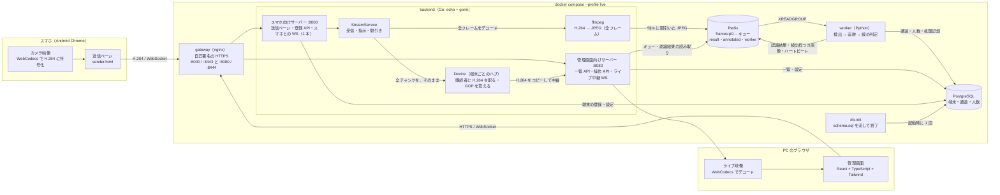

**読み方：** 認識用の経路は「スマホ → backend（ffmpeg でデコード、5fps に間引き）→ Redis → worker → PostgreSQL」。
ライブ用の経路は、デコードせずに、H.264 を管理画面のブラウザまで、そのまま届ける。

## 2. 認識の流れ（1 フレームの一生）

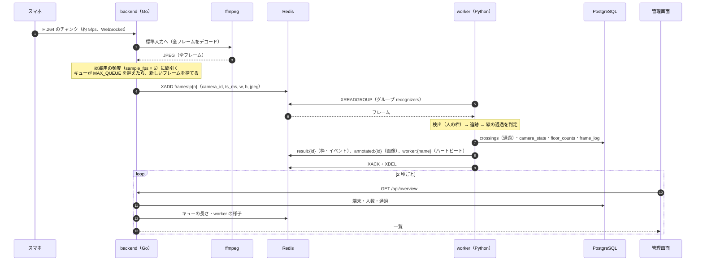

**パーティション：** 端末 ID の md5 を `PARTITIONS` で割った余りで、キュー（`frames:p0`…）が決まる（Go と Python で同じ計算）。
同じ端末のフレームは、必ず同じ worker が、積まれた順に処理する（追跡の状態を持つため）。

## 3. 端末ごとのハブ（Device）：購読者のコールバックに配る

スマホとの接続は、**1 台 1 本の WebSocket**（`/ws/:id`）。届いた H.264 のチャンクは、端末ごとのハブ（`Device`）に入り、登録されている購読者のコールバックに配られる。

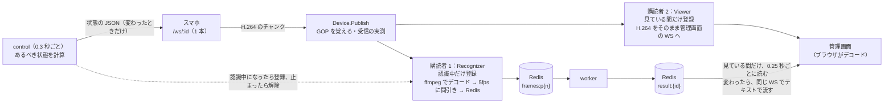

- 購読者が 1 つもなければ、届いたチャンクは、捨てる。普段（認識中だけ）は、Recognizer（Redis へ書く）の 1 つだけ。
- 見ている人は 2 種類。**一覧の小さな表示（thumb）**は、低い fps（`thumb_fps` = 1）でよく、時間の上限もない。**リアルタイム表示**は、高い fps（`live_fps` = 15）を頼む。どちらも、認識していなくても、見られている間は、スマホが送る。
- 見ている人がいる間だけ、Viewer が増える。新しい購読者には、覚えている GOP（最後のキーフレームから今まで）を最初に渡すので、途中から始めても映る。

## 4. スマホとサーバーのやり取り（1 本の WebSocket）

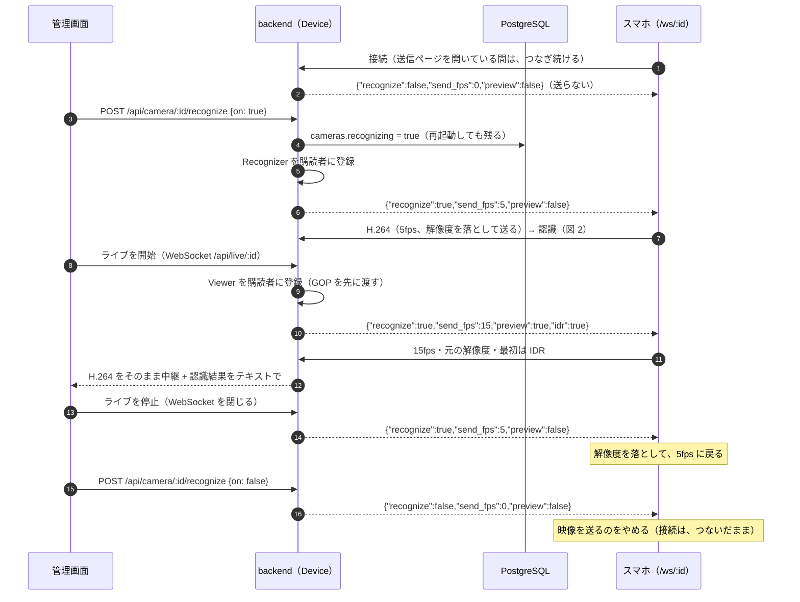

**スマホは、状態に従うだけ。** サーバーは、状態が変わったときだけ（念のため 10 秒ごとにも）、全体を 1 通で伝える。命令を何種類も送らないので、再接続しても、取りこぼさない。
認識中でなく、誰も見ていなければ、`send_fps` は 0。ライブだけを見る場合も、認識は始まらない（Recognizer は登録されず、数えない）。

## 5. スマホの送信ページの状態

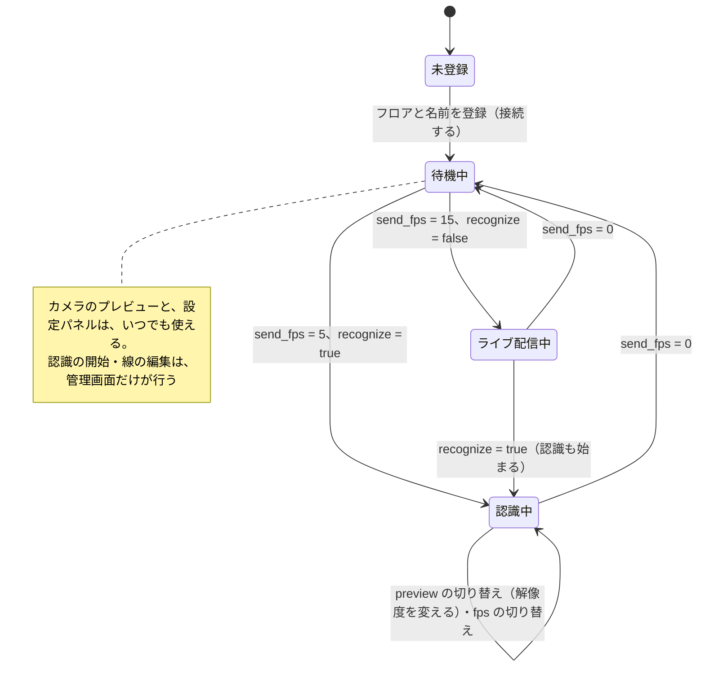

## 6. 線を越えたかの判定（worker）

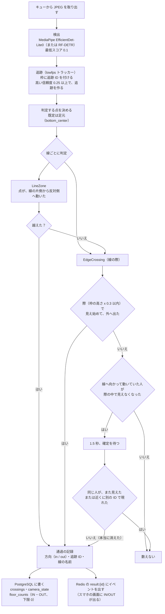

IN の向きは、線の始点から終点を見て、**画面の左側**。線の長さの範囲の外にいる人は、際の対象にしない（別の入口の前を通る人を数えないため）。

## 7. フロアの人数の概算

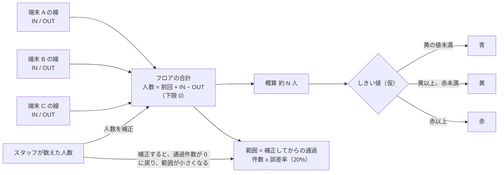

## 8. データの置き場所

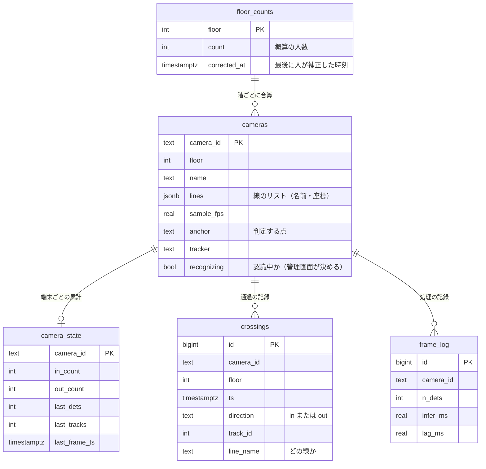

**Redis（消えてよい一時データ）**

| キー | 中身 | 書く人 → 読む人 |
|---|---|---|
| `frames:p{n}`（Streams） | 認識待ちのフレーム（JPEG）。グループ `recognizers` | backend → worker |
| `result:{id}` | 最新の認識結果（検出枠・イベント） | worker → backend → 管理画面・スマホ |
| `annotated:{id}` | 検出枠つきの最新画像（約 1 秒ごと） | worker → backend → 管理画面 |
| `worker:{name}` | worker のハートビートと処理の統計 | worker → backend（システムのページ） |

## 9. コードの構成

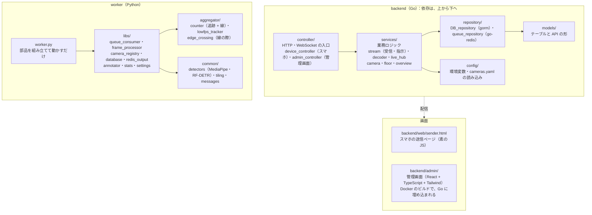

## 10. 管理画面の部品（端末 ID を渡すだけで使える）

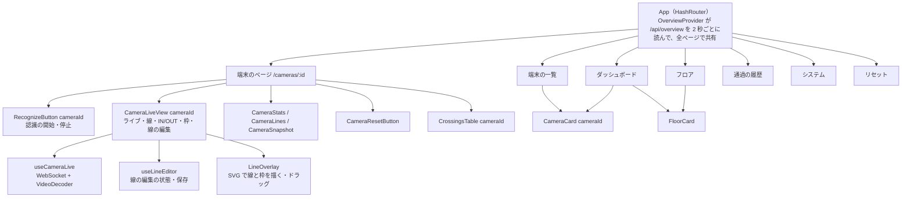

## 11. 起動の順序と、ポート

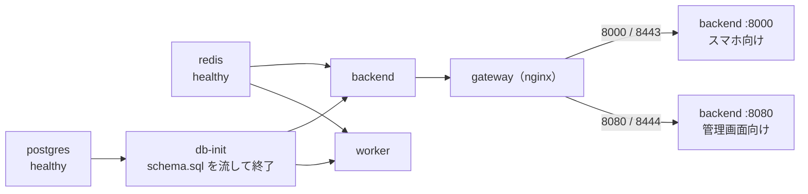

外へ公開するのは、gateway の 4 つのポート（8000・8080・8443・8444）だけ。redis・postgres・backend の直接のポートは、コンテナの中だけ。
