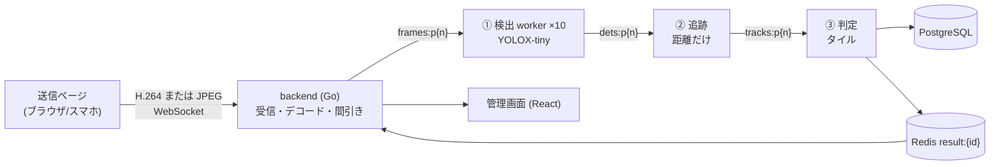
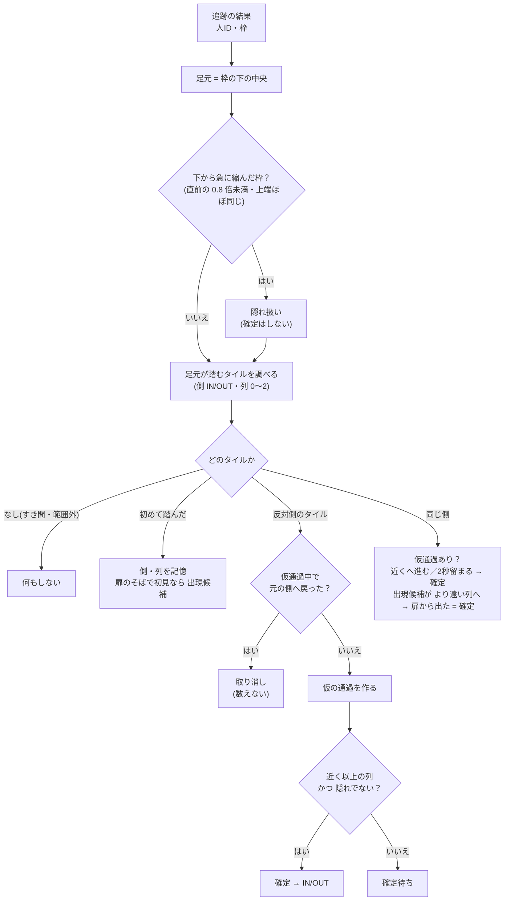
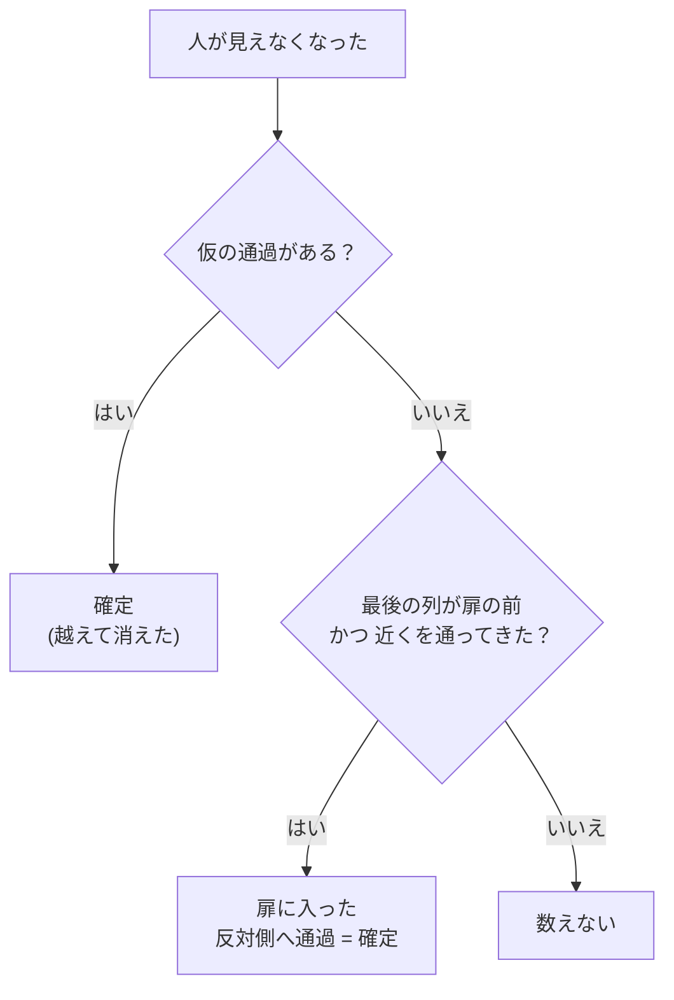
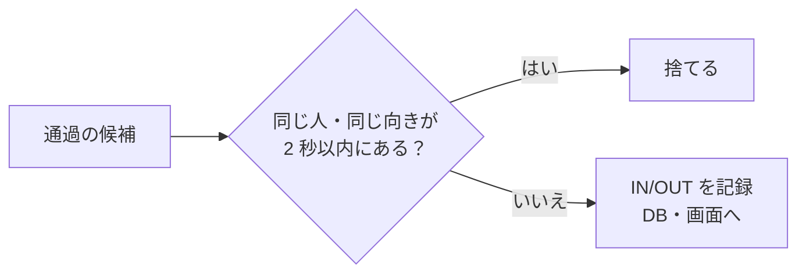

# 設計資料：入退室カウント（2026-11 時点）

スマホ・ブラウザのカメラ映像から、扉の線を通る人の IN/OUT を数え、フロアの人数を推定する。
この資料は現在の実装に合わせた最新版。[DETECTION.md](DETECTION.md)・[ARCHITECTURE.md](ARCHITECTURE.md) は旧方式の説明で、古い。

## 1. 全体像



- 3 段は別コンテナ。Redis Streams でつなぐ。同じ端末は必ず同じ分割 `p{n}` を通るので、順番が保たれる。
- ① だけが画像を見る（重いので並べる）。② ③ は座標だけ（軽いので 1 台ずつ）。

| 段 | ファイル | 役割 | 台数 |
|---|---|---|---|
| backend | `backend/services/` | 受信、ffmpeg デコード、5fps に間引き、キューへ | 1 |
| ① 検出 | `worker/worker.py` | JPEG → 人の枠（YOLOX-tiny 416、ONNX） | 10（CPU 2 個ずつ） |
| ② 追跡 | `worker/tracker.py` | 枠に人 ID を付ける | 1 |
| ③ 判定 | `worker/judge.py` | タイルを踏んだ並びで IN/OUT、DB 保存 | 1 |

## 2. 設定の場所

| 内容 | 場所 |
|---|---|
| fps（既定 5） | `config/cameras.yaml` の `sample_fps` / `normal_fps` |
| 追跡・判定の値 | `config/matrix.yaml` の `aggregator.tracker` / `aggregator.tiles` |
| 台数・CPU | `docker-compose.yml`（worker `replicas: 10`、`cpus: 2`） |
| 線・送り方 | 管理画面（DB の `cameras`） |

## 3. 判定ロジック（[tile_judge.py](worker/aggregator/tile_judge.py)）

線の両側にタイルを 3 列（扉の前・近く・遠く）自動で並べる。足元がどの列を踏んだかだけで決める。ベクトル・速度・スコアは使わない。

| # | 決まり | 数え方 |
|---|---|---|
| 1 | 反対側のタイルを踏んだ | 踏んだ側へ通過。越えた先が「扉の前」のうちは仮。近くへ進む／消える／2 秒留まるで確定。引き返したら数えない |
| 2 | 「近く → 扉の前」と来て 0.4 秒見えない | 扉に入った（OUT 側へ） |
| 3 | 扉のそばで初めて見え、より遠い列まで離れた | 扉から出てきた |
| A | 足元が隠れた枠（下から縮んだ）で越えた | 仮にして、消えたときだけ確定 |
| B | 同じ人・同じ向きは 2 秒に 1 回 | 近い線のタイルが重なっても二重に数えない |

### 3.0 タイルとは

線の両側に、床の上の帯を並べたもの。人の**足元の点**がどの帯を踏んだかだけを見る。

```
   奥（OUT 側 = 扉の中）          ※ 暗くて、ほぼ写らない
 ━━━━━━━━━━━ 線 ━━━━━━━━━━━
   すき間（約 1%）               ← タイルなし。足元がぶれても踏み替えない
   ┌───┬───┬───┬───┐
   │   │   │   │   │ 列0「扉の前」  奥行き = 画面の高さの 6%
   ├───┼───┼───┼───┤
   │   │   │   │   │ 列1「近く」
   ├───┼───┼───┼───┤
   │   │   │   │   │ 列2「遠く」
   └───┴───┴───┴───┘
   フロア側（IN 側）
```

- 反対側の帯にも、同じ 3 列を鏡写しで置く。線の両端より 25% 外まで並べる。
- 大きさは「画面の高さ」基準。線の長さ基準だと、長い線ではタイルが画面を覆ってしまう。
- 管理画面の検出画像に、IN 側は緑・OUT 側は橙で描かれる。

### 3.0.1 なぜ「急に現れた人」を特別扱いするのか

扉の中は暗く、人が**扉の外へ出てくる瞬間は、検出されない**。最初に検出されるのは、すでに扉を出て、線の手前（扉の前〜近く）に来てからになる。

```
 時間 →   [扉の中: 写らない]  →  [扉の前で初めて検出]  →  [近く]  →  [遠く]
                                      ↑ 反対側のタイルを踏んだ記録がない
```

踏んだタイルの並びだけでは「反対側 → こちら側」が見えず、IN を数えられない。そこで次の推理を入れている。

- 扉のそばで**初めて**見えた人は、扉から出てきた可能性が高い。
- ただし、扉の前でただ立っていた人・通りがかった人もいる。そこで、**初めて見えた列より遠くへ離れた**ときに、はじめて IN とする（離れた＝扉から遠ざかった＝出てきた、と見なす）。
- 逆に OUT は、「近く → 扉の前」と近づいて見えなくなったら、扉に入ったと見なす（入った先は写らないので、消えたことが証拠）。

つまり、**写らない区間を、「現れ方・消え方」で補っている**。

### 3.1 フローチャート

**1 フレームの流れ**（人ごと・線ごと）



**消えたとき**（0.4 秒見えない）



**確定するとき**



追跡（[simple_tracker.py](worker/aggregator/simple_tracker.py)）：中心の距離 ÷ 枠の高さが小さい組から貪欲につなぐ。上限 1.2、1 秒見えなければ忘れる。

## 4. 「同じフレームを 1 度だけ処理する」設計

- 送信ページが各フレームに撮影時刻を付ける（`HDF1`=H.264 / `HDJ1`=JPEG ＋ ms）。この時刻がフレーム ID。
- 映像が新しくならない間は送らない（止まった画面を再認識しない）。
- backend がスマホとサーバーの時計差を補正し、処理済みの時刻以前は認識に回さない。
- 各段は [once.py](worker/libs/once.py) で処理済み時刻以前を捨てる。③ は最後の時刻を DB に通過と同時コミットするので、再起動しても二重に数えない。

## 5. 映像の送り方

| | H.264（既定） | JPEG |
|---|---|---|
| 画質 | 端末の符号化器しだい | 品質値で一定 |
| 通信量(960×540,5fps) | 約 1Mbps | 約 2–3Mbps（推定） |
| デコード | ffmpeg | 不要 |

管理画面のカメラ設定「映像の送り方」で端末ごとに切替。JPEG は未実機検証。

## 6. 精度（正解 24 件の難しい動画）

| 方式 | 合致 | 数えすぎ |
|---|---|---|
| 旧：複雑な判定＋追跡（`_unused/backup/judge_v1/`） | 19.6 | 3.9 |
| 現行：タイル判定（3fps、ゆらぎ込み評価） | 約 21.3 | 約 4 |
| 現行（5fps 相当データ） | 約 22 | 約 6〜8 |

ほかの動画 4 本は 6/6・数えすぎ 0。ライブの一例は IN 11 / OUT 11、24 件中 20 合致。
残る弱点：扉前で 2 人がすれ違うと ID が入れ替わり IN を落とす／手前の人に足元を隠された枠が消えると OUT を余分に数える。

## 7. 評価の道具（`_unused/tools/eval/`）

- `robust_eval.py`：検出にゆらぎを加え何回も採点（平均と幅を見る。決まった入力だけで詰めると過学習する）
- `live_replay.py`：ライブで記録した検出結果（`_unused/outputs/live/*.jsonl`、worker が自動記録）を再生して採点
- `eval_episode.py`：ほかの動画 4 本・旧線での確認
- 正解：`hard_truth.json`（24 件）

## 8. 運用メモ

- worker は端末 1 台に 1 台が目安（CPU 2 個で約 7 枚/秒）。端末の分割への振り分けは固定なので、台数を変えたら偏りを確認する。
- リアルタイム表示は 5 秒ごとの ping で切断を検知し、閉じ忘れで 15fps のままになるのを防ぐ。
- 旧ロジックは `_unused/backup/judge_v1/` に退避済み。

## 9. 未了・次の課題

- JPEG 送信の実機検証、通信量と精度の比較
- すれ違い時の ID 入れ替わり対策
- 台数変更時の端末の再振り分け
- コミット（本資料の内容はすべて未コミット）、旧 md の更新
