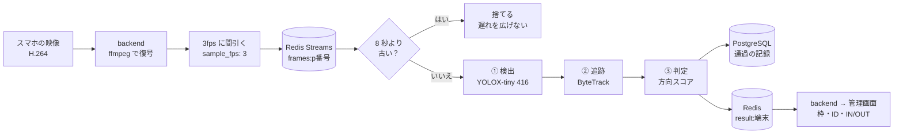
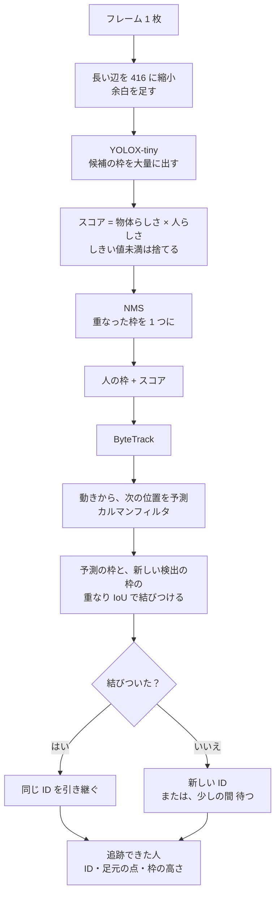
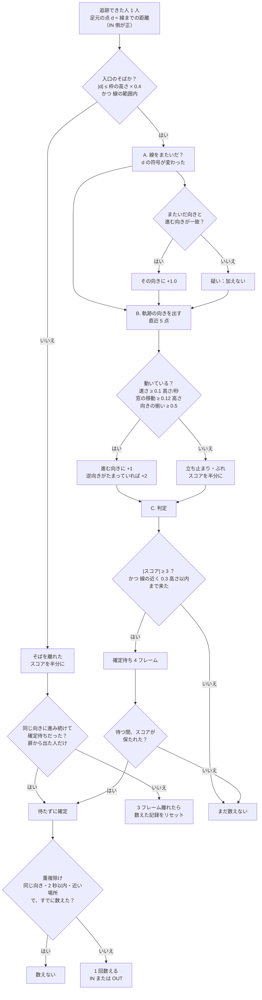
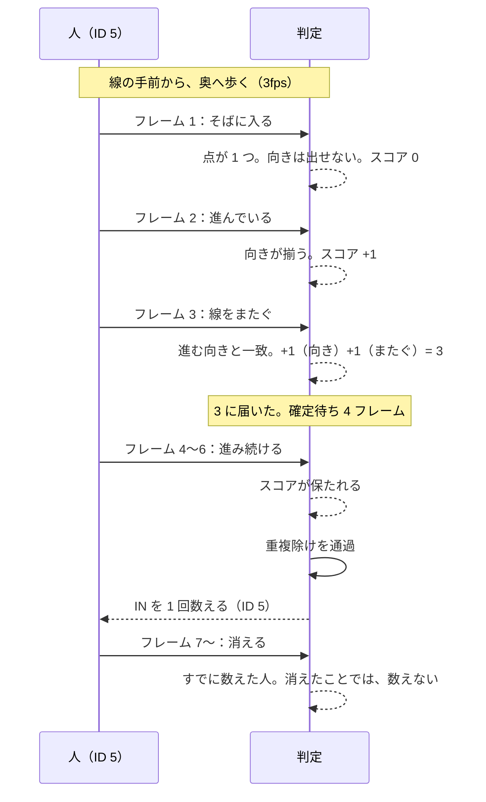

# 検出と、IN/OUT の数え方

映像から、「人が入口を出入りした」を数えるまでの流れを、図でまとめたもの。全体の構成は [ARCHITECTURE.md](ARCHITECTURE.md)、数値の理由は ARCHITECTURE の §12 を参照。
数値は、`config/matrix.yaml` と `config/cameras.yaml` の、現在の値。

## 1. 全体の流れ（1 フレームが通る道）

| 段 | やること | 使うもの | 学習済みモデルか |
|---|---|---|---|
| ① 検出 | 1 枚ごとに、人の枠を出す（前後のフレームは見ない） | YOLOX-tiny（Apache-2.0、onnxruntime、CPU） | はい |
| ② 追跡 | 前のフレームの人と結びつけて、ID を付ける | supervision の ByteTrack | いいえ（動きの予測と、枠の重なりだけ） |
| ③ 判定 | 軌跡を見て、IN / OUT を決める | `worker/aggregator/heading_gate.py` | いいえ（ルールとスコア） |

## 2. ① 検出 → ② 追跡

- **足元の点**：枠の下の中央。足の位置で、線との前後を見る。
- 追跡が切れて、ID が付け替わることがある（検出が粗いとき、人が重なったとき）。③ の重複除けは、そのための仕組み。

## 3. ③ 判定：人ごと・線ごとに、スコアをためる

線は、始点→終点に対して、**画面の左側が IN**、右側が OUT。スコアは、IN が＋、OUT が－。

### 3.1 スコアの上げ下げ（早見表）

| きっかけ | スコア | 理由 |
|---|---|---|
| 向きが揃って、線に対して進んでいる | その向きに ＋1（逆向きがたまっていれば ＋2） | 引き返しは、大きく下げたい |
| 立ち止まり・ぶれ・向きが定まらない | 半分にする | 立ち話では、たまらないように |
| 線をまたいだ（向きも一致） | ＋1.0 | 座標で分かる事実。ただし、これだけでは、確定しない |
| 反対向きに、5 秒以内に、またぎ返した | さらに ＋1（打ち消す向き） | IN/OUT が交互に出るのを防ぐ |
| 線の後ろで消えて、3 フレームたった | ＋2（待たずに判定） | 扉の中に入った人（OUT）など |
| 消えたあと、戻ってきて、逆向きに動いた | －3 | 消えたのは、誤検出だった |
| 線のそばで見え始めた人が、離れていく | 初期に ＋2 | 扉から出てきた人（履歴がない） |
| スコアの上限 | ±6 | たまりすぎて、戻れなくなるのを防ぐ |

### 3.2 数えない・数え直さない条件

| 条件 | 内容 |
|---|---|
| 線の近くまで来ていない | 線の手前を、通り過ぎただけの人は、数えない（0.3 高さ以内に来た人だけ） |
| すでに数えた人は、消えたことでは数えない | 1 人（1 つの ID）を、またぎと消えるで、2 回数えない |
| 同じ向きの連続 | 同じ ID が、同じ向きに、続けて数えられることはない。反対向きは、もう一度 ±3 までためたときだけ |
| 重複除け | 同じ線・同じ向きで、2 秒以内・枠の高さの 0.8 倍以内の数えは、1 回にまとめる（ID の付け替わり対策） |
| 画面の端で見え始めた人 | 扉から出てきたのではなく、画面に入ってきただけ。「扉から出た人」の扱いにしない |

## 4. 1 人が、IN と数えられるまで（例）

## 5. 設定の場所と、よく触る値

`config/matrix.yaml` の `aggregator` → `heading`。

| 値 | 現在 | 上げる／下げると |
|---|---|---|
| `threshold` | 3.0 | 上げる：誤検知が減る／数え漏れが増える |
| `confirm_frames` | 4 | 上げる：確定が遅い／取り消しが効く |
| `v_min` | 0.1 | 上げる：立ち止まりに強い／ゆっくり歩く人を、逃す |
| `min_win` | 0.12 | 同上（窓の中で、進んだ量） |
| `zone` / `reach` | 0.4 / 0.3 | 入口のそば・線の近く の広さ（枠の高さ × この値） |
| `dedupe_seconds` / `dedupe_dist` | 2.0 / 0.8 | 続けて入る人を、数え漏れるなら、短く・小さく |

そのほかの設定：`config/cameras.yaml`（`sample_fps` 3、`live.normal_fps` 3）、`docker-compose.yml`（`DETECTOR: yolox_tiny_416`）。
検出器の比較（広場の動画）：EfficientDet-Lite0 41%、YOLOX-tiny 67%、YOLOX-s 77%（基準は RF-DETR nano が見つけた人）。測定の道具は `_unused/tools/eval/crowd_models.py`。
