# 人検出・通過カウント 検証環境

スマホのカメラ映像（H.264）を **Go のバックエンド**で受け、**Python の worker** が人を認識し、
フロアごとの人数の概算を出す。管理画面では一覧と、リアルタイムのライブ表示が見られる。

```
スマホ（送信ページ）                         ┌────────────── backend（Go: echo + gorm）──────────────┐
  カメラ → H.264 → WebSocket ──────────────▶ │ ① 全チャンクをそのまま中継 ──────────────▶ 管理画面（ブラウザがデコード）
                                             │ ② ffmpeg でデコード → 5fps に間引き → JPEG ─┐
                                             └──────────────────────────────────────────│───────────┘
                                                                                        ▼
                                                                          Redis（キュー） ─▶ worker（Python）
                                                                                                  │ 検出 → 追跡 → 線の通過を判定
                                                                                                  ▼
                                                                                      PostgreSQL ◀── backend（一覧・人数の API）
```

- **間引きの順序：** H.264 は、途中のフレームを捨てるとデコードできない。そこで、バックエンドが全フレームをデコードしたあとに 5fps へ間引き、キューに積む。
- **ライブ表示：** デコードした画像は送らない。スマホから届いた H.264 を、**そのまま（コピーして）管理画面へ中継**し、デコードは管理画面のブラウザ（WebCodecs）が行う。
  ライブ中も、②（5fps の間引きとキュー登録）は止まらない。

## フォルダ

| フォルダ | 中身 |
|---|---|
| `backend/` | **Go**。`controller`（HTTP/WebSocket の入口）→ `services`（業務ロジック）→ `repository`（DB・Redis）→ `models`。`web/`（スマホの送信ページ）、`admin/`（管理画面：React + TypeScript + Tailwind。Docker のビルドで `web/admin_dist` に入り、Go に埋め込まれる）、`gateway/`（HTTPS 用の nginx） |
| `worker/` | **Python**。`worker.py`（起動）、`libs/`（処理の部品）、`aggregator/`（追跡・線の判定）、`common/`（検出器など）、`models/`（モデルの重み） |
| `database/` | `schema.sql`（テーブル定義。`db-init` が起動のたびに流す。何度流しても同じ） |
| `config/` | `cameras.yaml`（端末の既定・フロアのしきい値・ライブ表示）、`matrix.yaml`（トラッカー・検出の最低スコア） |
| `_unused/` | 使わないもの（以前のオフライン検証、Python 版のバックエンド、ゲート（ドアの領域）の方式、テスト送信ツール、サンプル動画など） |

`backend/` の構成（依存の向き：controller → services → repository → models）

| ファイル | 役割 |
|---|---|
| `main.go` | 部品を組み立て、2 つのサーバー（スマホ向け :8000、管理画面向け :8080）を起動 |
| `controller/device_controller.go` | スマホ向け：送信ページ、端末の登録・設定（線）、映像の受信（WS）、待機用の接続（WS） |
| `controller/admin_controller.go` | 管理画面向け：一覧、人数の補正・リセット、検出枠つき画像、ライブ中継（WS） |
| `services/stream_service.go` | 映像の受信、デコード → 間引き → キュー、端末への fps の指示 |
| `services/decoder.go` / `h264.go` / `live_hub.go` | ffmpeg の呼び出し、H.264 の解析、ライブ中継所（GOP を覚えておき、途中から見ても映る） |
| `services/camera_service.go` / `floor_service.go` / `overview_service.go` | 端末の登録・検証、人数の概算とリセット、管理画面の一覧 |
| `repository/` | gorm（PostgreSQL）、go-redis（キュー・worker の出力） |

`worker/libs/` の構成：`settings`（設定）、`queue_consumer`（キューの読み取り）、`frame_processor`（1 フレームの処理）、
`camera_registry`（端末の設定・追跡と線の状態）、`database`（DB 書き込み）、`redis_output`（認識結果・画像・ハートビート）、`annotator`（画像の描画）、`stats`（集計）。

## 構成図

図は Mermaid で書いてある（GitHub、VS Code の Markdown プレビューで、そのまま図になる）。

### 1. システム全体

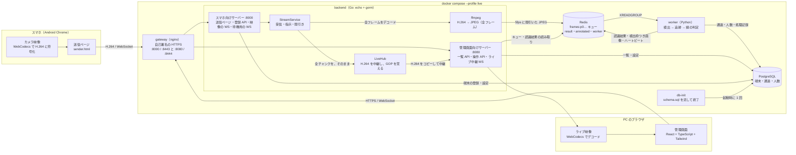

**読み方：** 認識用の経路は「スマホ → backend（ffmpeg でデコード、5fps に間引き）→ Redis → worker → PostgreSQL」。
ライブ用の経路は、デコードせずに、H.264 を管理画面のブラウザまで、そのまま届ける。

### 2. 認識の流れ（1 フレームの一生）

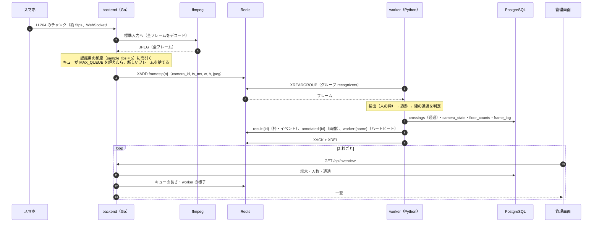

**パーティション：** 端末 ID の md5 を `PARTITIONS` で割った余りで、キュー（`frames:p0`…）が決まる（Go と Python で同じ計算）。
同じ端末のフレームは、必ず同じ worker が、積まれた順に処理する（追跡の状態を持つため）。

### 3. 認識の開始・停止（管理画面が決め、スマホは従う）

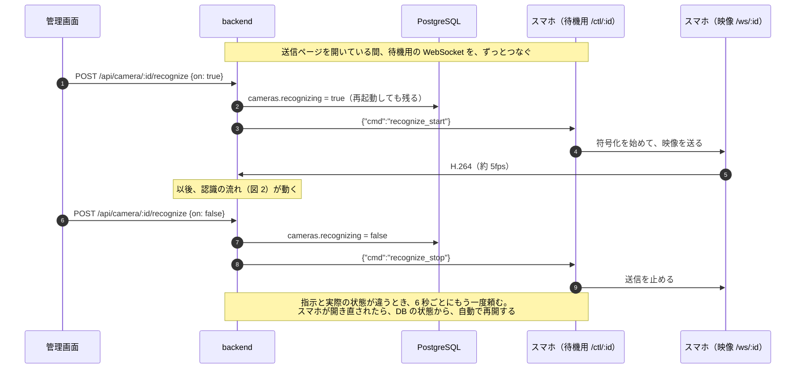

### 4. ライブ表示（見ている間だけ高い fps）

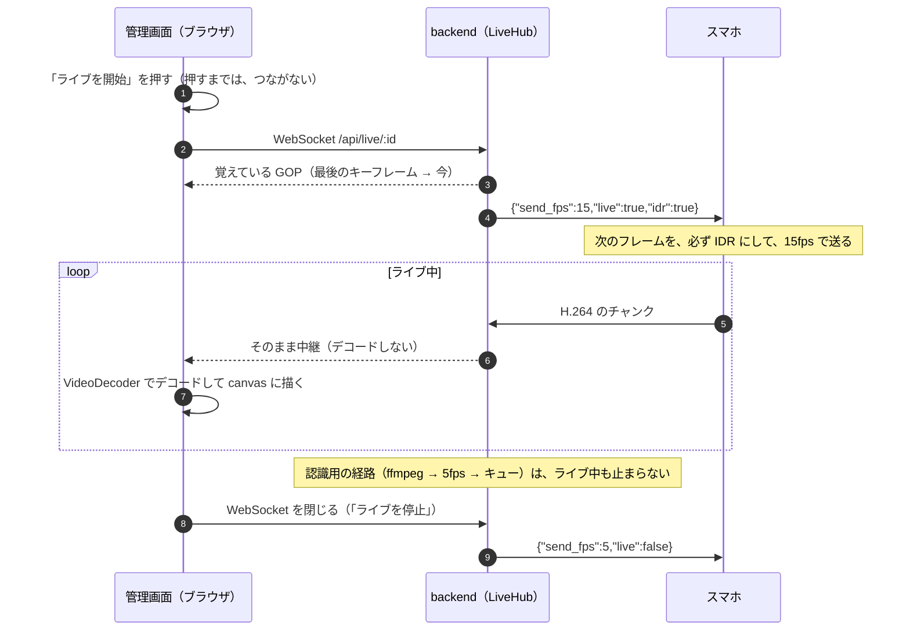

**認識を始めていない端末でも見られる：** スマホの送信ページが待機していれば、backend が待機用の接続から `live_start` を送る。
端末は、プレビュー専用（`?mode=live`）の映像を送る。この映像は、デコードも、認識も、数えもしない。

### 5. スマホの送信ページの状態

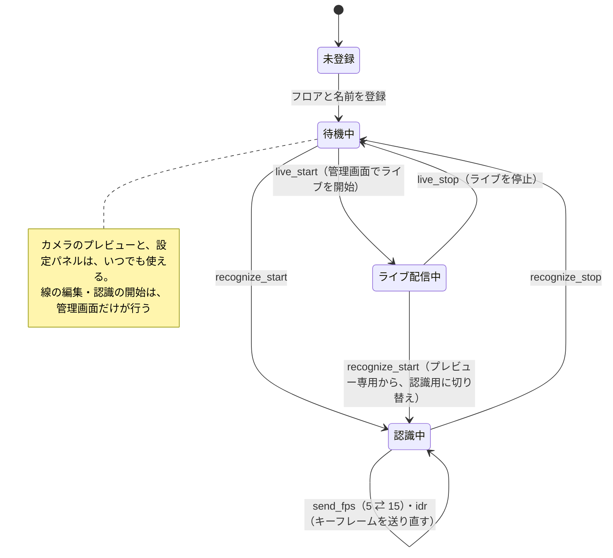

### 6. 線を越えたかの判定（worker）

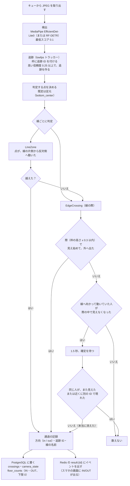

IN の向きは、線の始点から終点を見て、**画面の左側**。線の長さの範囲の外にいる人は、際の対象にしない（別の入口の前を通る人を数えないため）。

### 7. フロアの人数の概算

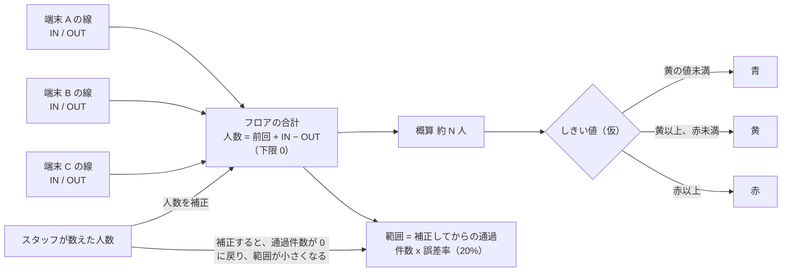

### 8. データの置き場所

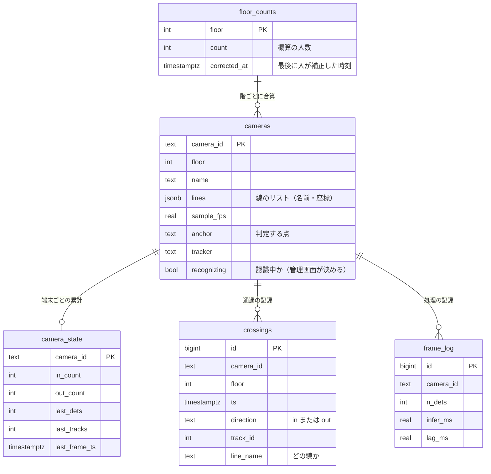

**Redis（消えてよい一時データ）**

| キー | 中身 | 書く人 → 読む人 |
|---|---|---|
| `frames:p{n}`（Streams） | 認識待ちのフレーム（JPEG）。グループ `recognizers` | backend → worker |
| `result:{id}` | 最新の認識結果（検出枠・イベント） | worker → backend → 管理画面・スマホ |
| `annotated:{id}` | 検出枠つきの最新画像（約 1 秒ごと） | worker → backend → 管理画面 |
| `worker:{name}` | worker のハートビートと処理の統計 | worker → backend（システムのページ） |

### 9. コードの構成

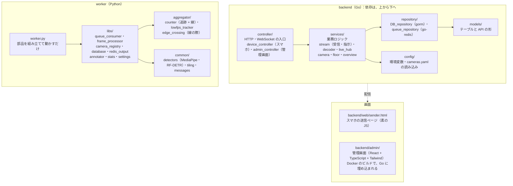

### 10. 管理画面の部品（端末 ID を渡すだけで使える）

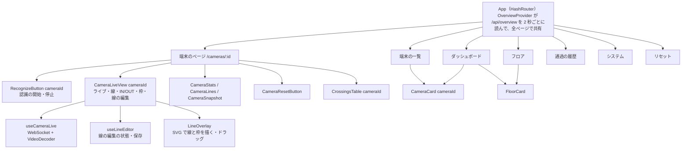

### 11. 起動の順序と、ポート

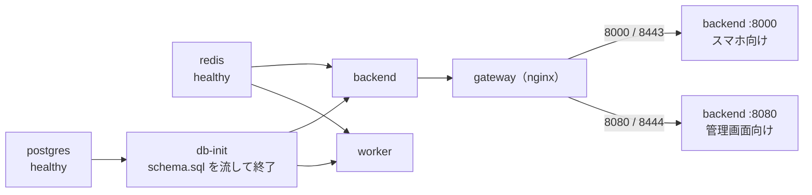

外へ公開するのは、gateway の 4 つのポート（8000・8080・8443・8444）だけ。redis・postgres・backend の直接のポートは、コンテナの中だけ。

## 環境構築（はじめから）

### 1. 必要なもの

| 項目 | 内容 |
|---|---|
| OS | Linux（動作確認は Debian 13、rootless の Docker）。Mac / Windows の Docker Desktop でも動くはず（未確認） |
| Docker | Docker Engine 24 以上、`docker compose`（v2）。**Go・Python・Node は、PC に入れなくてよい**（すべてコンテナの中でビルドする） |
| CPU・メモリ | 4 コア以上、メモリ 8GB 以上（worker が 2 コア・4GB まで使う。確認した環境は 24 コア・62GB） |
| ディスク | 約 6GB（イメージ 約 3GB、モデルの重み、DB） |
| ネットワーク | 初回のビルドで、パッケージ（apt・Go・npm・pip）とモデルの重みをダウンロードする。ビルドが終われば、インターネットは要らない |
| PC のブラウザ | Chrome / Edge（管理画面のライブ表示に、WebCodecs を使う） |
| スマホ | Android の Chrome（映像を H.264 にするため）。PC と**同じ Wi-Fi**。iPhone は未確認 |

管理画面（`backend/admin`）を作り変えるときだけ、Node 20 以上が要る（下の「管理画面の開発」）。

### 2. 起動

```bash
cd human-detect-test                      # このフォルダ（docker-compose.yml がある場所）
docker compose --profile live up -d --build
```

- 初回は、イメージのビルドとダウンロードがあるので、数分〜十数分かかる（ネットワークの速さ次第）。2 回目以降は、数秒。
- `--profile live` は、「通常の構成（redis・postgres・backend・gateway・worker）を起動する」という意味。付け忘れると、何も起動しない。
- 起動する順序は、自動で守られる：redis・postgres → `db-init`（テーブルを作る。終わると止まる）→ backend → gateway・worker。

起動したかの確認：

```bash
docker compose --profile live ps
```

次のようになっていれば成功。

| サービス | 期待する状態 |
|---|---|
| redis / postgres | `Up (healthy)` |
| db-init | `Exited (0)`（テーブルを作って終わった。正常。`ps` に出ないこともある） |
| backend / gateway / worker | `Up` |

worker は、最初の起動のとき、検出モデルを自動でダウンロードする（`worker/models/mediapipe/` に、数 MB）。次のログが出れば、準備完了。

```bash
docker compose --profile live logs -f worker      # 「開始: worker=… partitions=[0]」が出たら OK（Ctrl+C で抜ける）
curl -k https://localhost:8080/healthz            # {"ok":true} が返れば、バックエンドと gateway が動いている
```

### 3. 画面を開く

まず、**この PC の IP アドレス**を調べる（スマホから開くのに要る）。

```bash
hostname -I          # 例：192.168.2.10 172.30.1.1 …  （LAN 側のアドレスを使う。172.17.x.x や 172.30.x.x は、Docker 内部のことが多い）
```

| 画面 | URL | 誰が開く |
|---|---|---|
| **管理画面** | `https://<PCのIP>:8080`（この PC なら `https://localhost:8080`） | PC のブラウザ |
| **送信ページ（スマホ）** | `https://<PCのIP>:8000` | スマホの Chrome。または、テスト用に PC のブラウザ |

- `http://` で開いても、同じポートの `https://` に自動で転送される。8443 と 8444 でも、同じページが開く（以前の URL）。
- 証明書は、検証用の**自己署名**。最初に「保護されていません」と警告が出る。Chrome では「詳細設定 → `<IP>` にアクセスする（安全ではありません）」を押せば進める。IP が変わると、また出る。
- スマホのカメラと、管理画面のライブ表示（WebCodecs）は、**HTTPS でないと使えない**（ブラウザの決まり）。HTTPS にするために、gateway（nginx）がある。

### 4. ポートとファイアウォール

| ポート | 用途 | 外（LAN）に公開 |
|---|---|---|
| 8000（= 8443） | 送信ページ・スマホの WebSocket（gateway が HTTPS にして、backend:8000 へ） | する |
| 8080（= 8444） | 管理画面・API（gateway が HTTPS にして、backend:8080 へ） | する（認証はないので、LAN の中だけ） |
| redis・postgres・backend の直接のポート | コンテナの中だけ | しない |

PC のファイアウォールで、LAN からの 8000 / 8080 を許可する。例（ufw）：

```bash
sudo ufw allow from 192.168.2.0/24 to any port 8000,8080 proto tcp     # 自分の LAN のアドレス帯に直す
```

### 5. 止める・再起動・更新

```bash
docker compose --profile live down               # 止める（DB の中身は残る）
docker compose --profile live down -v            # 止めて、DB も消す（完全に初期化）
docker compose --profile live up -d              # 起動し直す（PC を再起動したあとは、自動では上がらない）
docker compose --profile live restart worker     # worker だけ再起動（config/matrix.yaml を変えたとき）
docker compose --profile live up -d --build backend   # Go や管理画面のコードを変えたとき（管理画面も、ここでビルドされる）
docker compose --profile live logs -f backend    # ログを見る（worker・gateway も同じ）
```

- `config/cameras.yaml` の端末や線の設定は、再起動なしで数秒後に反映される。`config/matrix.yaml`（追跡・検出）は、worker の再起動が要る。
- RF-DETR（重いが精度が高い検出器）に切り替える：`docker compose --profile live stop worker` のあと、`docker compose --profile live-rfdetr up -d --build worker-rfdetr`（同じキューを取り合うので、どちらか一方。重みの初回ダウンロードは、約 350MB）。

## 使い方

全体の流れ：**① スマホを三脚に置いて送信ページを開く → ② 管理画面で線を引く → ③ 管理画面で「認識を開始」→ ④ 人数を見る**。

### A. 管理画面（PC）

`https://<PCのIP>:8080`。左のサイドバーで、ページを切り替える。上のバーに、サービスの状態（ingest・Redis・Postgres・worker）が出る。赤い帯が出たら、その原因（worker 停止・キューの滞留など）が書いてある。

| ページ | 見るもの・できること |
|---|---|
| **ダッシュボード** | フロアごとの人数の概算（青・黄・赤）、端末のカード、直近の通過。全体を一目で見る |
| **フロア** | フロアのカード。「**人数を補正**」で、実際の人数に直す（そこから数え直して、範囲が小さくなる）。「IN/OUT 履歴を消す」 |
| **端末** | 端末の一覧（接続の状態・IN/OUT・検出数）。押すと、その端末のページへ |
| **端末のページ** | 下の「端末のページの使い方」 |
| **通過の履歴** | いつ・どの端末・どの線で・IN か OUT かの記録（新しい順） |
| **システム** | キューの待ち、worker の処理状況（推論時間・遅れ）、直近 60 秒の処理量 |
| **リセット** | 全フロアを 0 に戻す（閉場）、IN/OUT の履歴を全部消す、全部リセット。どれも確認してから実行 |

#### 端末のページの使い方

端末ごとの操作は、すべてここにある。

1. **認識を開始 / 停止**（右上）：スマホに「映像を送って」と指示する。押すと、数秒でスマホが約 5fps で送り始め、「認識中」に変わる。
   「スマホ未接続」のときは、スマホで送信ページを開く（開いた時点で、自動で始まる）。
2. **ライブ**：「ライブを開始」を押している間だけ、映像がリアルタイムで出る（端末は、この間だけ 15fps で送る。押さなければ、高い fps は頼まない）。
   - 映像には、数える線・IN の矢印・累計 IN/OUT・線ごとの IN/OUT・認識結果の枠が重なる。「全画面」もある。
   - 認識を開始していない端末でも見られる（スマホの送信ページが開いていれば、プレビュー専用の映像が届く。数えない）。
3. **線を編集**（ライブを開始すると押せる）：
   - 端の○をドラッグ → 線の形。線の上をドラッグ → 線ごと移動。「＋ 線を足す」「選んだ線を消す」、名前の欄で名前を変える。
   - 入口の足元の**少し手前の床の上**に置く（「数える線」の項を参照）。「保存」で、数秒後に認識側へ反映される。
   - 固定の端末（SAMPLE-1/2）は、編集できない。
4. **数字**（IN/OUT・検出数・デコードの数・破棄）、**数える線**の一覧、**認識結果の画像**（2 秒ごとの静止画）、**この端末の通過**の表。
5. 「IN/OUT 履歴を消す」：この端末の記録と累計を消す（フロアの人数の概算は変わらない）。

### B. 送信ページ（スマホ）

`https://<PCのIP>:8000`。**スマホは、管理画面の指示に従って映像を送り、結果を画面に出すだけ。**

1. 初回は、**フロア（階）と端末の名前**を入れて「登録」する。端末 ID が付く（例 `F2-789E`）。フロアごとに、何台でも登録できる。
2. カメラの許可を「許可」にする。映像が**全画面**で映る。三脚に置いて、見せたい範囲（入口）が映るように向きを合わせる。**画面は点けたまま**にする（消すと、ブラウザが止まる）。
3. 下の帯には、状態（**待機中** / **認識中** / ライブ配信中）が出る。管理画面で「認識を開始」すると、自動で送り始めて「認識中」になる。映像には、認識結果（検出枠・追跡番号・IN/OUT）が重なる。
4. 右上の **⚙ 設定**：カメラの選択（広角レンズ）、解像度・縦横比、ズーム（既定は 4:3・ズーム最小の、いちばん広い設定）、**プレビューの表示 ON/OFF**（スマホが熱いときは切る。送信は続く）、認識の頻度、送信の状況、履歴のリセット、登録の解除。
5. **⛶**：ブラウザの全画面（アドレスバーを消す）。**🎞 動画**：動画ファイルをカメラの代わりに流す（次の項）。

スマホが熱いときは、プレビューを切る、画面の明るさを下げる、が効く。ライブ表示の fps は、管理画面から見ている間だけ上がる。

### C. スマホなしで試す（テスト動画）

実機がなくても、動画ファイルで、全体の流れを試せる。

**方法 1：送信ページで、動画ファイルを選ぶ（おすすめ）**

1. PC のブラウザで `https://<PCのIP>:8000`（または `https://localhost:8000`）を開き、端末を登録する。
2. 下の帯の **「🎞 動画」** を押して、動画ファイルを選ぶ。動画が、くり返し再生される。**「📷 カメラに戻す」** で、カメラに戻る。
3. 管理画面で、その端末のページを開き、線を引いて、「認識を開始」を押す。
- 動画は、**H.264 の mp4**にする（HEVC・H.265 のスマホ動画は、ブラウザによって、途中までしか再生できない）。変換例：
  `ffmpeg -i 元の動画 -an -vf fps=30 -c:v libx264 -crf 20 -pix_fmt yuv420p 出力.mp4`
- 使っているブラウザが、H.264 の符号化に対応していないと、「H.264 の符号化に対応していません」と出る（Linux の Chrome・Chromium に多い）。その場合は、方法 2 を使う。

**方法 2：コマンドで流す（ブラウザ不要）**

```bash
docker compose --profile stream run --rm stream-test      # SAMPLE-1 に、サンプル動画を流す
```

- 流す動画・宛先は、`docker-compose.yml` の `stream-test` の `command:` で変える（宛先の末尾の `/ws/SAMPLE-1` を、端末 ID に）。
- サンプル動画は、容量が大きいので、Git に入れていない（`_unused/data/videos/samples/` に自分で置く）。人が通る、H.264・5fps の mp4 を、`/data/videos/…` の形で指定する。
- 固定の端末 SAMPLE-1 / SAMPLE-2 には、入口ごとの線が、あらかじめ引いてある（エレベーターホールの動画用）。

### D. うまく動かないとき

| 症状 | 原因と対処 |
|---|---|
| ページが開かない | `docker compose --profile live ps` で、gateway と backend が `Up` か確認。ファイアウォールで 8000 / 8080 を許可。`https://` で開く（IP は、LAN 側のアドレス） |
| 「保護されていません」と出る | 自己署名なので、正常。「詳細設定 → 進む」 |
| 「このページでは映像を符号化できません」/「カメラを使えません」 | HTTP で開いている。`https://` で開く |
| 「H.264 の符号化に対応していません」 | ブラウザに、H.264 の符号化機能がない。Android の Chrome を使う。PC では、Windows / Mac の Chrome。または、C の方法 2 |
| ライブが映らない | 管理画面を `https://` で開いているか。端末のページで、「ライブを開始」を押したか。スマホの送信ページが開いたままか（画面を消さない） |
| 「認識を開始」を押しても、始まらない | 「スマホ未接続」なら、スマホで送信ページを開く。数秒待つ。 `docker compose --profile live logs backend` に、「端末に指示 …: recognize_start」が出ているか確認 |
| 人が通っても、数えられない | 線が、人の足元が通る場所にあるか（ライブ表示で確認）。入口のすぐ手前の床の上に置く。それでも数えられない場合は、「線のぎりぎり（edge_margin）」の項 |
| 数えすぎる | 線の上で立ち止まる人がいる。`config/matrix.yaml` の `aggregator.min_crossing_seconds` を上げる（0.4 など）、`edge_margin` を下げる |
| 画面に赤い帯（worker 停止・キューの滞留） | `docker compose --profile live logs worker`。端末が多いと、worker 1 台（約 6 枚/秒）では足りない |
| 動画の一部しか流れない | 元の動画が HEVC。H.264 に変換する（C の変換例） |
| 全部やり直したい | `docker compose --profile live down -v` のあと、`up -d --build`（DB が空になる） |

## 数える線（入口が複数あっても、線を複数置く）

- 1 台のカメラに、**線を何本でも**引ける（1 本以上、12 本まで）。入口・エレベーター・階段が複数写るなら、入口ごとに線を引く。
- **線は、入口の足元のすぐ下（手前の床の上）に、ドアの縁と同じ傾きで引く。** 人が入口に入るとき、足元がその線を越える。
  ドアのすぐ前は暗くて検出が不安定なので、縁からドアの高さの 1 割ほど手前に引くと、安定する（実測：縁の直前だと、出てくる人を取りこぼした）。
- 人の枠のどの位置が線を越えたら数えるかは、送信ページで選べる（既定は**足元**）。**線は、その位置が通る場所に引く**。
  足元 / 体の中心 / 頭 / 人の枠全体。判定は 2 次元で、線の向きは縦・横・斜めのどれでもよい。
  「枠全体」は、枠が線をまたいだまま消える場所（ドアに入る人）では数えられないので、おすすめしない。
- 人が線を越えた向きで IN / OUT を数える。IN の向きは、**始点→終点に対して画面の左側**（送信ページの矢印の向き）。
- 追跡は 1 つで、線ごとに別々に数える。通過の記録には**線の名前**が入り、管理画面の履歴と、スマホの画面（線ごとの IN/OUT）で見られる。
- フロアの人数は、全端末・全線の IN − OUT の合算。
- 注意：同じ人が 2 本の線を越えれば、それぞれで数える。同じ通り道に線を重ねて置かない。名前は線ごとに別のものにする（同じ名前は登録できない）。
- 越えたあと、その側にとどまる時間（`aggregator.min_crossing_seconds`）は 0。5fps で 0.3 秒だと 2 フレームとどまる必要があり、
  越えた直後にドアへ消える人を数えられない。線の上で立ち止まる人が多い場所では、0.4 などに上げる（二重に数えるのを防ぐ）。

## フロア人数の概算

- **概算 = そのフロアの全端末の IN − OUT の合算**（下限 0）。**範囲 = 補正してからの通過件数 × 誤差率**（`estimate.error_rate`、仮に 20%）。
- 管理画面で「人数を補正」すると、そこから数え直して範囲が小さくなる。青・黄・赤は `floors:` のしきい値（仮）。
- 端末が付いていない出入口の人は数えられない。

## 線のぎりぎり（edge_margin）

入口の足元にぎりぎりに線を置くと、人が線をまたぐ瞬間が、映像に残らないことがある（暗いドアの中は検出できない）。
そこで、線の近く（人の枠の高さ × `aggregator.edge_margin`、既定 0.3）を「線の際」として、次の場合も 1 回数える（`worker/aggregator/edge_crossing.py`）。

- 際で見え始めた人が、際の外へ出たら、出た側へ越えたとして数える（ドアから出てくる人）。
- 際の外から、**線へ向かって動いていた**人が、際の中で見えなくなったら、反対側へ越えたとして数える（ドアへ入る人）。
  見えなくなってから `edge_confirm_seconds`（既定 1.5 秒）は、確定を待つ。同じ人がまた見えたり、すぐ近くに別の追跡IDで現れたりしたら、検出の取りこぼしとして数えない。そのまま現れなければ、本当に消えたとして数える。
- 線の長さの範囲の外（別の入口の前など）や、すでに線で数えた人は、数えない。

サンプル動画で、線を元の位置から動かしながら比べた（5fps）。際なしでは、線をドア側へ寄せると 0〜1 件になったが、際ありでは、IN と OUT が 1 件ずつ数えられる位置が増えた。
誰も通らない線（EV6・EV7）は 0 件のまま。広場の動画は、数が変わらなかった。線の上で立ち止まる人が多く、誤って数えるときは、`edge_margin` を下げる（0 で、無効）。

## ライブ表示（管理画面）

端末のページの **「ライブを開始」** を押している間だけ、その端末の映像がリアルタイムで出る。押さなければ（ページを開いただけでは）、端末に高い fps を頼まない。
- 映像には、**数える線（名前・IN の矢印）、この端末の累計 IN/OUT、線ごとの IN/OUT、認識結果の枠**が重なる（枠はチェックで切替）。「全画面」もある。
- 見ている間だけ、端末は 15fps で送る（止めると 5fps に戻る）。ライブ中の fps は `live.live_fps`（上げるほど滑らかだが、スマホが熱くなる）。
  ライブを始めた直後と、新しく見始めた人が現れたときは、端末が必ず IDR（キーフレーム）を送り直す。
- **認識を始めていない端末でも見られる。** スマホの送信ページを開いて待機していれば、ライブを開いた間だけ、サーバーが「配信を始めて」と頼み、
  端末は**プレビュー専用**の映像を送る（認識・IN/OUT のカウントには使わない）。
- バックエンドは H.264 をデコードせず、そのまま中継する。最後のキーフレームから今までを覚えているので、途中から見ても映る。
- 上限は 10 分（`live.max_seconds`）。ブラウザ（管理画面）がデコードできない場合（HTTP、古いブラウザ）は、その旨が表示される。
- スマホ側は、画面を消したり別のアプリに切り替えたりすると、ブラウザが止まって配信できない。

## IN/OUT の履歴のリセット

通過の記録と、端末ごとの累計 IN/OUT を消す。**フロア人数の概算は変わらない**（「全部リセット」は両方）。

| どこから | 範囲 |
|---|---|
| 管理画面の端末のページ / フロアのカード / 「リセット」ページ | 端末 / フロア / 全端末（「全部リセット」＝履歴＋全フロアの人数） |
| スマホの送信ページの「⚙ 設定」 | この端末、または「全部リセット」 |

## 設定（`config/cameras.yaml`）

- `defaults`：全端末の既定（認識に回す頻度 `sample_fps`＝5、`tracker`、`anchor`＝頭/足元、`tiling`）。
- `live`：ライブ表示（`normal_fps`＝5、`live_fps`＝15、`max_seconds`）。
- `estimate` / `floors`：概算の誤差率、フロアの青・黄・赤のしきい値。
- 端末は送信ページから登録する（DB に入る。線は何本でも引ける）。`cameras:` には固定のカメラ（テスト用 SAMPLE-1/2。線は 1 本）を書ける。設定は再起動なしで反映される。

## 動作確認の結果（2026-10-27、PC 上）

**実際に撮ったエレベーターホールの動画（人が 1 人、階段室に入って出てくる）で、スマホ相当の流れ（H.264・5fps → Go → キュー → worker → DB）を確認した。**
- 入口ごとの線（階段・エレベーター 2 基）で、階段の入口に **IN（入る）→ OUT（出る）の順に 1 回ずつ**数えられた。誰も通らないエレベーターの線は 0 件（誤検出なし）。
  SAMPLE-1/2 の 2 台 × 3 回、毎回同じ結果。受信 62 フレーム、キュー登録 62、取りこぼし 0、worker の遅れは平均 約 175ms。
- 確認の過程で、次の問題を見つけて直した：
  - **ffmpeg の指定の不具合**：`-fflags nobuffer` を付けると、ffmpeg がフレームの大半を捨てる（64 枚中 14 枚）。`-analyzeduration 0` は「既定（5 秒）」の意味で、
    5fps の端末だと 25 秒も画像が出てこない。25fps のサンプルでは目立たず、5fps の動画で初めて分かった。`backend/services/decoder.go` に理由を書いてある。
  - **線の位置**：ドアの縁の直前に線を引くと、暗いドアの中から出てくる人を、検出される前に越えさせてしまい、取りこぼす。
  - **判定する位置**：床に引いた線を、頭で判定すると越えない。既定を足元にした。
  - **追跡を作る信頼度**：暗いドアから出てくる人は検出の信頼度が低い（0.14〜0.36）。しきい値を 0.4 → 0.25 にした（広場の動画の数は変わらなかった）。
- 広場の動画（人が多い、以前のサンプル）でも、IN 10 / OUT 10 で、全フレームで数えた基準とほぼ同じだった。
- ライブ中継：8 秒で 248 チャンクが届き、PyAV で 245 フレームをデコードできた（エラー 0）。見始めてから最初のチャンクまで 0.05 秒。視聴中だけ端末に 15fps が指示され、離れると 5fps に戻った。
- 待機中の端末に「配信を始めて」と頼む経路：配信が始まり、止まり、通過の記録は 0 件のまま。
- 線を複数置いた端末で、通過が線ごとに分かれて記録された。同じ名前や 0 本の線は、登録時に断られた。
- **スマホの実機、ブラウザの WebCodecs でのデコード（管理画面のライブ表示）は未確認。** 人 1 人・1 往復の短い動画なので、混雑時や複数人が同時に通る場面の精度は測れていない。手持ち撮影の動画で、画面が揺れていた。

## 既知の限界・注意

- worker 1 台（MediaPipe EfficientDet-Lite0、2 コア）の処理能力は約 6 枚/秒。端末が増えて合計が超えると、キューが溜まって遅れる（管理画面に警告）。
- 追跡の状態は worker のメモリ上。再起動すると追跡 ID が振り直しになる（累計は DB に残る）。
- 認証はない（検証用。LAN の中だけで使うこと）。
- RTSP / RTMP の受信は未対応。
- ライブ表示は約 5Mbps（元の映像の大きさ次第）で管理画面へ流れる。
- スマホの発熱：映像の符号化と、画面の描画が主な原因。ライブ中の fps を下げる（`live.live_fps`）、プレビューを切る、画面の明るさを下げる、が効く。

## 環境のメモ

- この環境の Docker は rootless。コンテナ内の http の Debian ミラーが 404 になるので、apt は https に書き換えている（worker の Dockerfile）。
- Go の依存は、Go 1.25 で動く版に固定している（echo v4.13.4、go-redis v9.7.3 など。最新版は Go 1.26 を要求する）。

## 管理画面の開発（backend/admin）

React + TypeScript + Tailwind（Vite）。左のサイドバーから、ダッシュボード / フロア / 端末 / 通過の履歴 / システム / リセット へ。
端末 ID を渡すだけで使える部品にしてある（`src/components/camera/`）。

| 部品 | 内容 |
|---|---|
| `<CameraLiveView cameraId>` | ライブ映像 + 線 + IN/OUT + 検出枠 + 線の編集（ドラッグ・追加・削除・名前・保存） |
| `<CameraCard cameraId>` / `<CameraSnapshot>` / `<CameraStats>` / `<CameraLines>` / `<CameraResetButton>` | 一覧のカード、認識結果の画像、数字、線の一覧、履歴リセット |
| `<CrossingsTable cameraId?>` | 通過の記録（端末を指定すると、その端末だけ） |

```bash
cd backend/admin && npm install
npm run dev     # http://localhost:5173（API は :8080 へ流れる）
npm run build   # 型チェック + ビルド（本番は docker compose build が自動で行う）
```
